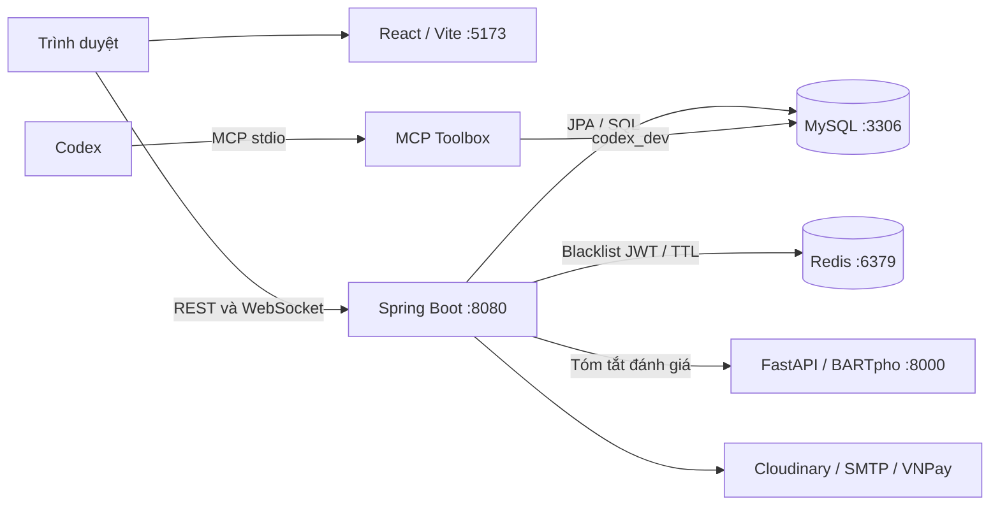

# Kiến trúc RestNesst

[Tổng quan dự án](../README.md) · [Database](database.md) · [Phát triển local](development.md)

## Các module

| Thư mục | Công nghệ | Trách nhiệm |
| --- | --- | --- |
| `frontend/` | React 18, Vite, MUI, React Router, Redux | Giao diện guest, host, admin; gọi API và nhận tin nhắn |
| `airbnb_service/` | Java 17, Spring Boot 3.3.8, Spring Security, JPA, MapStruct | Xác thực, phân quyền, listing, booking, thanh toán, đánh giá và chat |
| `ai-service/` | FastAPI, PyTorch, Transformers, BARTpho | Tóm tắt văn bản, đánh giá và tài liệu tiếng Việt |
| `tools/database-toolbox/` | MCP Toolbox, Python | Công cụ thao tác MySQL dev dành cho Codex, độc lập với runtime ứng dụng |
| `docs/` | Markdown | Kiến trúc, dữ liệu và hướng dẫn phát triển toàn hệ thống |

## Kết nối khi chạy local

Mô hình hiện được hướng dẫn là frontend, backend và AI chạy trên máy; MySQL và Redis chạy trong Docker.



Backend hiện không cần MongoDB. `compose.redis.yaml` chỉ khai báo Redis; chưa có Compose chạy toàn bộ hệ thống. Các tích hợp Cloudinary, SMTP, VNPay và bản đồ cần cấu hình riêng để sử dụng chức năng tương ứng.

## Backend: các tầng và luồng xử lý

Source nằm trong `airbnb_service/src/main/java/com/pbl5cnpm/airbnb_service/`.

| Package | Vai trò |
| --- | --- |
| `controller/` | Nhận HTTP request, lấy thông tin người dùng, gọi nghiệp vụ và trả response |
| `service/` | Validation, quy tắc nghiệp vụ, điều phối repository và dịch vụ ngoài |
| `repository/` | JPA, truy vấn custom và native SQL |
| `mapper/` | Chuyển entity ↔ DTO bằng MapStruct; một số mapper hiện có truy cập repository/dịch vụ |
| `entity/` | Ánh xạ bảng và quan hệ MySQL |
| `dto/Request`, `dto/Response` | Hợp đồng dữ liệu vào/ra API |
| `configuration/`, `exception/` | Cấu hình Spring/Security và ánh xạ lỗi |
| `seed/` | Công cụ dữ liệu mẫu được chạy chủ động |

Hướng tổ chức khi phát triển là controller xử lý HTTP, service giữ nghiệp vụ, repository giữ truy vấn. Source hiện có một số trách nhiệm còn nằm trong controller/mapper; bảng trên không khẳng định mọi luồng đã tách hoàn toàn.

Các luồng chính:

- **Tài khoản và xác thực:** MySQL lưu user/role và mật khẩu băm BCrypt. Redis lưu token bị thu hồi theo `jti`; TTL theo thời điểm hết hạn token. Redis không lưu hồ sơ user hay thay MySQL.
- **Đăng ký làm host:** cờ `users.host_application_pending` biểu thị yêu cầu chờ duyệt. Quyền HOST được quản lý qua `roles`/`user_roles`, tách biệt với cờ này.
- **Chỗ ở và đặt phòng:** listing liên kết host, quốc gia, danh mục, tiện ích và ảnh. Booking nằm trong bảng `booked`; payment tham chiếu booking. Giữ kiểm tra trạng thái và phân quyền của từng luồng khi refactor.
- **Yêu thích:** `FavoriteController` → `FavoriteService` → `FavoriteRepository`; quan hệ user/listing có khóa ghép và cờ xóa mềm.
- **Chat:** tin nhắn giữa user được lưu MySQL và truyền qua WebSocket của Spring Boot.
- **Tóm tắt đánh giá:** `ListingsController` → `AiSummarizeService` → FastAPI `POST /api/summarize-text`. Service chuyển tên tham số Java sang JSON dạng snake_case; lỗi kết nối được ánh xạ thành `AI_SERVICE_UNAVAILABLE`.

Nhiều endpoint sử dụng `ApiResponse`. Trường `code` trong JSON không tự quyết định HTTP status; đọc controller và cấu hình exception khi thay đổi hợp đồng API. Giữ nguyên cả các tên cũ như `amenites`, `thumnailUrl`, `deteted`, `avgStart` cho tới khi có kế hoạch migration cụ thể.

## Frontend: tổ chức theo nghiệp vụ

```text
frontend/src/
├── app/          # App, providers, router, layouts, store
├── features/     # auth, listings, bookings, host, admin, chat, reviews...
├── shared/       # components, hooks, api, config, theme, utils, assets
└── styles/       # Style dùng chung
```

- `app/` ghép ứng dụng; component riêng của nghiệp vụ ở feature tương ứng.
- Chỉ chuyển code sang `shared/` khi có nhu cầu dùng chung thực tế.
- Dùng alias `@/` cho import giữa thư mục; import tương đối cho file gần nhau.
- `src/shared/config/environment.js` đọc `VITE_BACKEND_URL`, mặc định `http://localhost:8080`; client chính là `src/shared/api/httpClient.js`.
- Khi đổi địa chỉ backend, kiểm tra đồng thời REST, URL ảnh, Vite proxy và SockJS/WebSocket. Khởi động lại Vite sau khi đổi env.

Quy ước chi tiết: [kiến trúc frontend](../frontend/docs/architecture.md).

## Dịch vụ AI và các tích hợp riêng

Trong `ai-service/`, `api.py` ghép ứng dụng; `app/routes.py` định nghĩa API, `schemas.py` giữ hợp đồng, `preprocessing.py` đọc/làm sạch văn bản và `summarizer.py` quản lý inference. `model_service.py` giữ facade tương thích ngược.

Model mặc định ở `best_model_v2/`; có thể đổi bằng `AI_MODEL_PATH`. Model được tải khi khởi tạo service nên thiếu trọng số/dependency có thể khiến API chưa khởi động được. Backend đọc `ai.service.url`, mặc định `http://localhost:8000`.

AI tóm tắt này khác với caller chatbot ở cổng 3000 và phân tích cảm xúc ở cổng 5000 được nhắc trong README cũ. Không chuyển các caller đó sang BARTpho khi chưa đối chiếu hợp đồng và dịch vụ thực tế.

## Cấu hình, ảnh và dữ liệu

Backend dùng [application.yml](../airbnb_service/src/main/resources/application.yml). Bí mật phải được cấp qua môi trường hoặc cấu hình local bị Git bỏ qua; không sao chép giá trị thật vào tài liệu.

Ảnh local nằm trong `airbnb_service/src/main/resources/static/uploads/`, được tham chiếu qua `/uploads/...`. Đây là file trên ổ đĩa backend, không phải browser `localStorage`. Một số luồng upload dùng Cloudinary; giữ nguyên cách lưu URL theo từng luồng.

Xem [database.md](database.md) để biết bảng, Redis và quy tắc seed; xem [development.md](development.md) để chạy và kiểm tra từng module.
