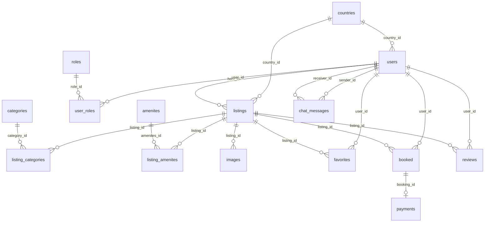

# Database RestNesst

[Kiến trúc](architecture.md) · [Phát triển local](development.md)

## Phân chia dữ liệu

| Thành phần | Vai trò | Đích dev từ máy host |
| --- | --- | --- |
| MySQL | User, role, chỗ ở, booking, thanh toán, đánh giá, chat | `127.0.0.1:3306`, database `johunter11` |
| Redis | Blacklist JWT có TTL | `127.0.0.1:6379` |

MySQL dev được hướng dẫn chạy bằng Docker với image `mysql:8.4.10`, container `restnesst-mysql`. Redis được khai báo trong [compose.redis.yaml](../compose.redis.yaml) bằng image `redis:7.4-alpine`, bật AOF và `noeviction`. Đây là cấu hình dự kiến, không phải xác nhận container đang chạy ở thời điểm đọc tài liệu.

Backend hiện không yêu cầu MongoDB. Nếu nâng cấp từ phiên bản cũ có MongoDB, đọc [hướng dẫn chuyển dữ liệu backend](../airbnb_service/README.md) trước khi bỏ dữ liệu cũ.

## Các bảng MySQL

Bảng dưới mô tả mô hình entity hiện tại; để biết kiểu cột, default, index và constraint thực tế của database đang chạy, dùng công cụ xem schema thay vì suy ra từ tài liệu.

| Nhóm | Bảng | Nội dung và liên kết chính |
| --- | --- | --- |
| Tài khoản | `users` | Username, mật khẩu băm, hồ sơ, quốc gia, trạng thái và `host_application_pending` |
| Phân quyền | `roles`, `user_roles` | Role và quan hệ nhiều-nhiều user/role |
| Dữ liệu nền | `countries`, `categories`, `amenites` | Quốc gia, danh mục và tiện ích |
| Chỗ ở | `listings` | Tham chiếu `host_id` → users và `country_id` → countries |
| Phân loại | `listing_categories`, `listing_amenites` | Các bảng nối listing với danh mục/tiện ích |
| Ảnh | `images` | Ảnh thuộc listing qua `listing_id` |
| Yêu thích | `favorites` | Khóa ghép user/listing, có cờ xóa mềm `deteted` |
| Đặt phòng | `booked` | User, listing, ngày nhận/trả, tổng tiền, trạng thái, cờ xóa/đánh giá |
| Thanh toán | `payments` | `booking_id` bắt buộc và unique; phương thức, trạng thái, mã giao dịch |
| Đánh giá | `reviews` | User, listing, nội dung và điểm đánh giá |
| Chat | `chat_messages` | Người gửi và người nhận đều tham chiếu users |

Tên bảng `amenites`, bảng `booked` và các tên field/cột cũ được giữ để tương thích. Không tự sửa chính tả trong SQL hoặc entity.

## Quan hệ chính

Sơ đồ tập trung vào khóa ngoại; các bảng nối được biểu diễn riêng.



Một số khóa ngoại như quốc gia có thể để trống tùy entity; sơ đồ không thay thế thông tin nullable trong schema. `payments.booking_id` thể hiện quan hệ một booking có tối đa một payment theo entity hiện tại.

## Ràng buộc cần lưu ý

- `users.username` unique và bắt buộc; tạo tài khoản phải tuân theo validation và cơ chế BCrypt hiện có. Không lưu mật khẩu rõ hoặc ghi hash vào báo cáo.
- Yêu cầu làm host là cờ trên users; cấp quyền HOST thông qua bảng role. Không coi cờ chờ duyệt là quyền truy cập.
- Nhiều nghiệp vụ dùng xóa mềm. `deleted`, `is_active` và `deteted` không có nghĩa tương đương; kiểm tra service/repository trước khi sửa dữ liệu.
- `reviews` yêu cầu user, listing, nội dung và rating. Booking yêu cầu user/listing; payment yêu cầu booking.
- `BaseEntity` cung cấp thông tin audit cho các entity kế thừa; không phải mọi bảng đều có cùng bộ cột audit.

## Khởi tạo schema và dữ liệu nền

Backend hiện dùng Hibernate `spring.jpa.hibernate.ddl-auto: update`; chưa có bộ migration Flyway/Liquibase trong cấu trúc hiện tại. Database `johunter11` phải tồn tại trước khi backend kết nối. Hibernate có thể tạo/cập nhật bảng, nhưng không tự tạo database.

`ApplicationInitConfig` tạo dữ liệu nền và tài khoản dev theo điều kiện của code khi Spring khởi động. Khởi động backend có thể ghi dữ liệu; không dùng cách này để preview seed hoặc kiểm tra chỉ đọc. Với database đã có dữ liệu, kiểm tra từng điều kiện khởi tạo trước khi kỳ vọng thêm mới.

Tài khoản runtime backend và tài khoản công cụ `codex_dev` có vai trò khác nhau. `codex_dev` chỉ có `SELECT`, `INSERT`, `UPDATE`, `DELETE` trên `johunter11.*`, không đủ quyền DDL để Hibernate cập nhật schema. Thay đổi schema cần kế hoạch và quyền quản trị riêng.

## Blacklist Redis

`InvalidTokenRepository` sử dụng `StringRedisTemplate`:

- Key: `restnesst:auth:blacklist:<jti>`.
- Giá trị đánh dấu token đã bị thu hồi; TTL theo hạn token.
- Logout/kiểm tra token sử dụng blacklist theo luồng authentication hiện có.
- Giữ dữ liệu Redis khi dừng dịch vụ. Mất blacklist trong khi token còn hạn có thể làm mất thông tin thu hồi; không xóa Redis để khắc phục lỗi đăng nhập.
- Khi Redis gặp lỗi, không bỏ qua kiểm tra để coi token là hợp lệ.

## Xem schema và dữ liệu bằng MCP

Đọc [quy tắc thao tác database](../tools/database-toolbox/AGENTS.md) và [Toolbox README](../tools/database-toolbox/README.md).

Từ repo gốc, kiểm tra chỉ đọc:

```bash
python3 tools/database-toolbox/check_connection.py
```

Các tool có sẵn gồm `mysql-connection-info`, `mysql-list-tables`, `mysql-describe-table`, `mysql-list-foreign-keys`, `mysql-dev-data-counts`. Không ghi số bản ghi hiện tại vào tài liệu như một giá trị cố định.

Mật khẩu công cụ nằm trong môi trường hoặc `tools/database-toolbox/.local/credentials.json` bị Git bỏ qua, quyền `0600`. Không đưa bí mật vào Git, hội thoại hoặc đối số lệnh.

## Dữ liệu mẫu

| Bộ seed | Tài liệu/catalog | Preview từ repo gốc |
| --- | --- | --- |
| Tiện ích và ảnh local | [Catalog](../airbnb_service/scripts/seed/amenities.json), [ảnh](../airbnb_service/src/main/resources/static/uploads/amenities/README.md) | `python3 tools/database-toolbox/seed_amenities.py` |
| Khách sạn Đà Nẵng và tài khoản giả | [Bản xem trước, nguồn và điều kiện apply](../airbnb_service/scripts/seed/PREVIEW.md) | `bash airbnb_service/scripts/seed-danang.sh --preview` |

Lệnh preview khách sạn có bước Maven compile chuẩn bị công cụ nhưng không khởi động Spring hoặc ghi database. Ảnh tiện ích dùng đường dẫn `/uploads/amenities/...`; ảnh khách sạn mẫu dùng placeholder. Giá và tài khoản demo phải được nhận diện rõ trong preview.

Chỉ apply sau khi người dùng xác nhận danh sách cụ thể. Chạy lại phải bỏ qua bản trùng và giữ dữ liệu cũ. Trước UPDATE/DELETE cần ID, đọc dòng thật, trình bày tác động và chờ xác nhận; dùng `row_version` nếu tool yêu cầu, rồi đọc lại sau khi ghi. Xem hướng dẫn riêng của mỗi seed để biết phạm vi transaction và báo cáo lỗi; không suy ra mọi seed đều commit toàn bộ trong một transaction.
